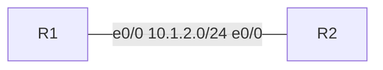

# [LAB] <EXAM> <id> <Topic> – learn-<name>

> **Blueprint:** <EXAM> <id> — <exact exam topic text>
> **Nodes:** <n> licensed (<list>) · **Time:** ~<min> min · **Prereqs:** <labs or concepts>

## What you'll learn
- <Objective 1 — stated as something you can observe, e.g. "See why R3 becomes the DR on 10.0.1.0/24">
- <Objective 2>

## Topology



### Addressing

| Device | Interface | IPv4 | IPv6 | Connects to |
|---|---|---|---|---|
| R1 | Lo0 | 10.255.255.1/32 | 2001:db8:ffff::1/128 | — |

## Starting point
<What is already configured when the lab boots (base config, IPs) and what isn't.>

## Tasks

### Task 1 — <title>
<Instructions. Say *what* to achieve; reveal the commands only in a collapsed hint.>

<details><summary>Hint</summary>

```
<commands>
```
</details>

**Verify**
```
R1# show ...
```
Look for: <the specific line/field and value that proves it worked>.

**Why it works this way:** <2–4 sentences on the mechanism.>

### Task 2 — ...

## Check yourself
- <Question that tests understanding, answerable from what they saw>

## Clean up
Stop and wipe the lab from the CML UI, or `uv run tools/cml_teardown_lab.py`.

---
*Full final configs and captured output: [`solution/`](solution/).*
