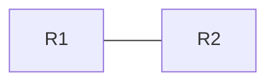

# [LAB] <EXAM> <id> <Topic> – ts-<name>

> **Blueprint:** <EXAM> <id> — <exact exam topic text>
> **Nodes:** <n> licensed · **Faults:** <count> · **Difficulty:** <1–3> · **Time:** ~<min> min

## Ticket

> **#<number> — <short symptom title>**
> <What the user/NOC reports, in their words. Symptoms only — never the cause.>
> e.g. "Users in VLAN 20 can't reach the file server at 192.168.50.10 since this morning's change window.
> VLAN 10 is fine."

## Topology

### Addressing (as designed)

| Device | Interface | IPv4 | IPv6 | Connects to |
|---|---|---|---|---|

## Intended design
<How the network is *supposed* to work: protocols, areas/AS, policies. The faults are deviations from this.>

## Your job
1. Reproduce the symptom.
2. Isolate the fault(s) using show/debug output — write down the evidence that pointed you there.
3. Fix with the smallest change that restores the intended design.
4. Prove it's fixed (see "Done when").

## Done when
- <Concrete test, e.g. `PC2# ping 192.168.50.10` succeeds and `R2# show ip route 192.168.50.0` shows an OSPF route>

## Hints

Hint 1 — where to look

<Narrow down the layer/device without naming the fault.>

Hint 2 — what to compare

<Point at the command whose output differs from what you'd expect.>

Hint 3 — almost there

<Names the feature at fault, not the fix.>

---
*Root cause and fix: [`solution/root-cause.md`](solution/root-cause.md) — try first.*

<!--
solution/root-cause.md template:

# Root cause — ts-<name>

## Fault 1: <name>
- **Where:** R2, interface e0/1
- **Injected change:** `<exact config line>`
- **Why it causes the symptom:** <mechanism>
- **Evidence:** <the show output that reveals it, captured from the lab>
- **Fix:** `<config>`
- **Verify:** `<command>` → <expected>
-->
